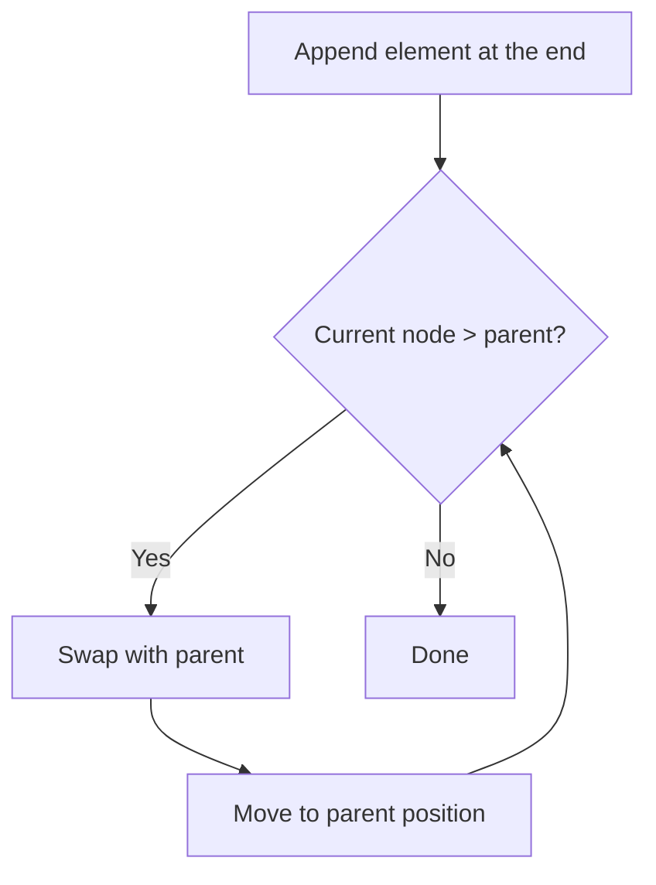
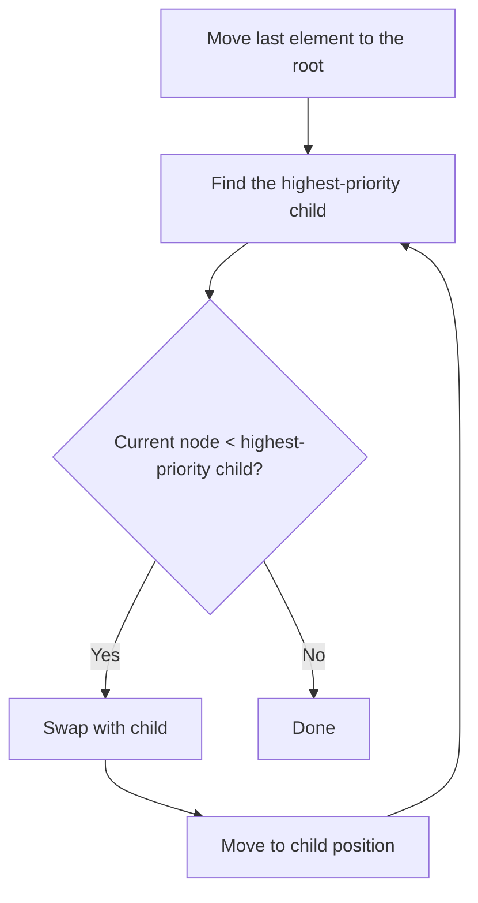

# Heap Data Structure in C

[](https://en.wikipedia.org/wiki/C99)
[](LICENSE)

A general-purpose heap implementation in C, built only on the standard library. It supports min heaps and max heaps, the usual heap operations, and heap sort.

## Contents

- [Features](#features)
- [Project Structure](#project-structure)
- [Quick Start](#quick-start)
- [API](#api)
- [How It Works](#how-it-works)
- [Sample Output](#sample-output)
- [Author](#author)

## Features

- **Min and max heap** — both modes supported
- **Dynamic array** — grows automatically as elements are added
- **O(n) build** — uses Floyd's heap construction
- **Heap sort** — in-place, ascending or descending
- **Tree printing** — prints the heap as a tree for inspection
- **Standard C only** — no dependencies beyond the C standard library

## Quick Start

### Build and run

```bash
# GCC
gcc -o heap heap.c

# Run
./heap
```

Use your actual source filename if it differs from `heap.c`.

### Basic usage

```c
#include <stdio.h>

// Create a min heap
Heap* minHeap = heapCreate(4, MIN_HEAP);

// Push elements
heapPush(minHeap, 5);
heapPush(minHeap, 3);
heapPush(minHeap, 8);

// Peek at the top
int top;
heapPeek(minHeap, &top);
printf("top: %d\n", top);  // prints: top: 3

// Pop the top
int val;
heapPop(minHeap, &val);

// Destroy the heap
heapDestroy(minHeap);
```

## API

### Data structures

```c
typedef enum {
    MIN_HEAP,   // parent <= children
    MAX_HEAP    // parent >= children
} HeapType;

typedef struct {
    int* data;          // element array
    int size;           // current element count
    int capacity;       // array capacity
    HeapType type;      // heap type
} Heap;
```

### Functions

| Function | Description | Time complexity |
| ---------------------------------- | ---------------- | ---------- |
| `heapCreate(capacity, type)` | Create a heap | O(1) |
| `heapDestroy(h)` | Destroy a heap | O(1) |
| `heapPush(h, value)` | Push an element | O(log n) |
| `heapPop(h, outValue)` | Pop the top | O(log n) |
| `heapPeek(h, outValue)` | Peek at the top | O(1) |
| `heapSize(h)` | Get the element count | O(1) |
| `heapIsEmpty(h)` | Check whether the heap is empty | O(1) |
| `heapBuild(arr, n, type)` | Build a heap from an array | O(n) |
| `heapRemoveAt(h, index, outValue)` | Remove the element at an index | O(log n) |
| `heapPrint(h)` | Print the heap (level order) | O(n) |
| `heapPrintTree(h)` | Print the heap as a tree | O(n) |
| `heapSort(arr, n, ascending)` | Heap sort | O(n log n) |

## How It Works

### Heap property

A heap is a complete binary tree with one extra rule:

- **Min heap**: every node is less than or equal to its children
- **Max heap**: every node is greater than or equal to its children

### Core operations

#### 1. Heapify up

After a push, move the new element up until the heap property holds:



#### 2. Heapify down

After removing the top, move the last element down from the root:



#### 3. Floyd's build

Start at the last non-leaf node and heapify down, working bottom-up:

```
Complexity:
- Nodes on level h need 0 adjustments
- Nodes on level h-1 need at most 1
- ...
- Nodes on level 0 need at most h

Total: T(n) = O(n)
```

### Complexity

| Operation | Time | Space |
| -------- | ---------- | ---------- |
| Push | O(log n) | O(1) |
| Pop | O(log n) | O(1) |
| Peek | O(1) | O(1) |
| Build | O(n) | O(1) |
| Heap sort | O(n log n) | O(1) |

## Sample Output

```bash
C:\Users\anjuxi\Desktop\heap>a.exe
=== Heap Test ===

[Min heap]
Insert order: 5 3 8 1 9 2 7 4 6
MinHeap (size=9, capacity=16): 1 3 2 4 9 8 7 5 6

MinHeap Tree Structure:
        1
      3  2
  4  9  8  7
  5  6

Pop order: 1 2 3 4 5 6 7 8 9

[Max heap]
Insert order: 5 3 8 1 9 2 7 4 6
MaxHeap (size=9, capacity=16): 9 8 7 6 3 2 5 1 4

MaxHeap Tree Structure:
        9
      8  7
  6  3  2  5
  1  4

Pop order: 9 8 7 6 5 4 3 2 1

[Floyd build]
Input array: 3 1 6 5 2 4
Result: MinHeap (size=6, capacity=6): 1 2 4 5 3 6

MinHeap Tree Structure:
      1
    2  4
  5  3  6

[Heap sort]
Input array: 64 34 25 12 22 11 90
Ascending: 11 12 22 25 34 64 90
Descending: 90 64 34 25 22 12 11

[Remove at index]
MinHeap (size=9, capacity=16): 1 3 2 4 9 8 7 5 6
Removed element at index 3: 4
MinHeap (size=8, capacity=16): 1 3 2 5 9 8 7 6

MinHeap Tree Structure:
        1
    3  2
  5  9  8  7
6


=== All tests finished ===
```

## Author

**Ailan Anjuxi (谙弆悕博士)**

- Email: [anjuxi.ME@outlook.com](mailto:anjuxi.ME@outlook.com)
- SIP: [sip:anjuxi@sip.linphone.org](sip:anjuxi@sip.linphone.org)

---

*This project is for learning and teaching. Discussion is welcome.*
