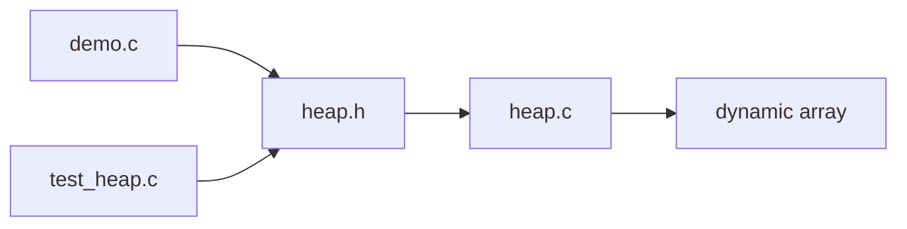
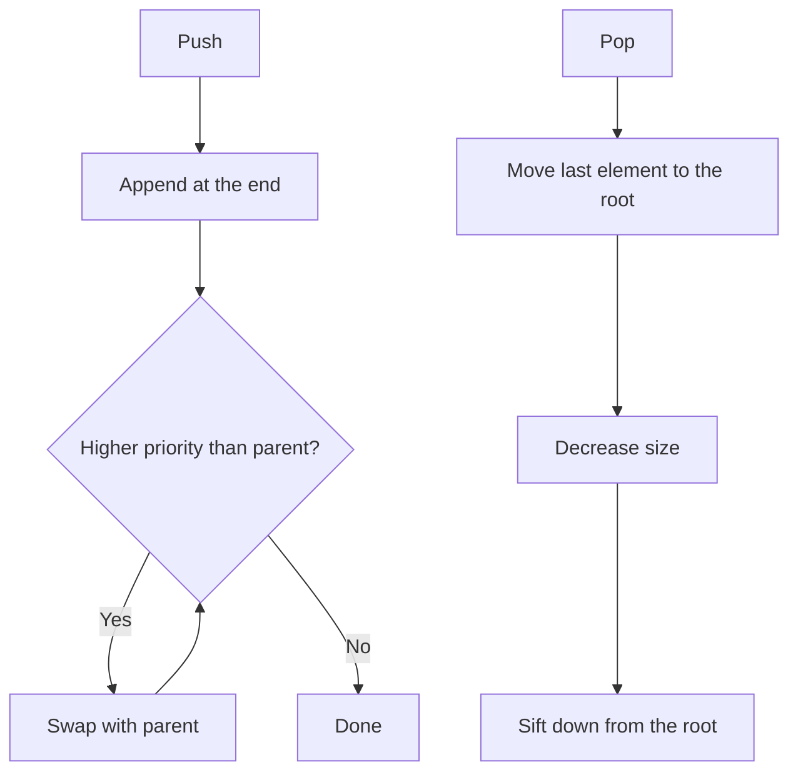

# Heap in C

[](https://en.wikipedia.org/wiki/C99)
[](LICENSE)

English | [中文](README_cn.md)

## Introduction

This started as a data structure exercise. The goal was not just to demo a few operations in `main`, but to build a small library that can be dropped into another project: the interface lives in `heap.h`, the implementation in `heap.c`, and min heap and max heap share the same code with only the comparison direction changed.

What it supports:

- Min heap and max heap
- Dynamic growth, capacity doubles when needed, amortized O(1) per push
- Build from an array with Floyd's algorithm, O(n)
- In-place heap sort, ascending or descending
- Pop, peek, and remove by index
- Level-order and tree printing for debugging
- Safe handling of empty heaps, `NULL`, and out-of-range indexes

Callers only depend on `heap.h`:



Push and pop are the two core operations:



## Dependencies

No third-party dependency. All you need is a C99 compiler.


I built it with GCC 15.2 and `-std=c99 -Wall -Wextra`, with no warnings. Nothing here is platform specific, so Clang should work too, though I have not verified it point by point.

## Project Structure

```
.
├── heap.h        public interface
├── heap.c        implementation
├── demo.c        demo program
├── test_heap.c   tests
├── LICENSE
├── README.md     English
└── README_cn.md  Chinese
```

## Usage

Two gcc commands are enough. No Makefile or CMake needed.

```bash
# demo
gcc -std=c99 -O2 -Wall -Wextra -o demo demo.c heap.c
./demo

# tests
gcc -std=c99 -O2 -Wall -Wextra -o test_heap test_heap.c heap.c
./test_heap
```

On Windows the output files are `demo.exe` and `test_heap.exe`; run them from PowerShell or CMD. There are 7 test groups, and the process exits with 0 when all of them pass.

Basic usage:

```c
#include "heap.h"

Heap *h = heap_create(0, MIN_HEAP);  // 0 means: allocate on first push.
heap_push(h, 5);
heap_push(h, 3);
heap_push(h, 8);

int top;
heap_peek(h, &top);  // top = 3

int value;
heap_pop(h, &value); // value = 3

heap_destroy(h);
```

Queries return 0 or `false` when `heap` is `NULL`; mutating calls return `false`. `out_value` may be `NULL` if you only care whether the operation succeeded.

| Function | What it does | Time |
| ---------------------------------------- | ------------------------------- | ---------- |
| `heap_create(capacity, type)` | Create a heap, `capacity` may be 0 | O(1) |
| `heap_destroy(heap)` | Free the heap | O(1) |
| `heap_push(heap, value)` | Insert a value | O(log n) |
| `heap_pop(heap, out_value)` | Remove and return the top | O(log n) |
| `heap_peek(heap, out_value)` | Read the top | O(1) |
| `heap_remove_at(heap, index, out_value)` | Remove the element at an index | O(log n) |
| `heap_size(heap)` | Number of elements | O(1) |
| `heap_capacity(heap)` | Current capacity | O(1) |
| `heap_is_empty(heap)` | Whether the heap is empty | O(1) |
| `heap_type(heap)` | Heap type | O(1) |
| `heap_build(arr, n, type)` | Build from an array | O(n) |
| `heap_print(heap)` | Print in level order | O(n) |
| `heap_print_tree(heap)` | Print as a tree | O(n) |
| `heap_sort(arr, n, ascending)` | Sort an array in place | O(n log n) |

## Contributing

Open an issue if you find a bug. Include the input that reproduces it and your compiler version.

If you want to change the code, run `test_heap` first and make sure `-Wall -Wextra` stays clean. If a public interface changes, update the header comments, the tests, and both READMEs. A short commit message explaining what changed and why is enough.

## Author

Ailan Anjuxi (谙弆悕博士)

📫 Email: anjuxi.ME@outlook.com

📞 SIP: sip:anjuxi@sip.linphone.org
