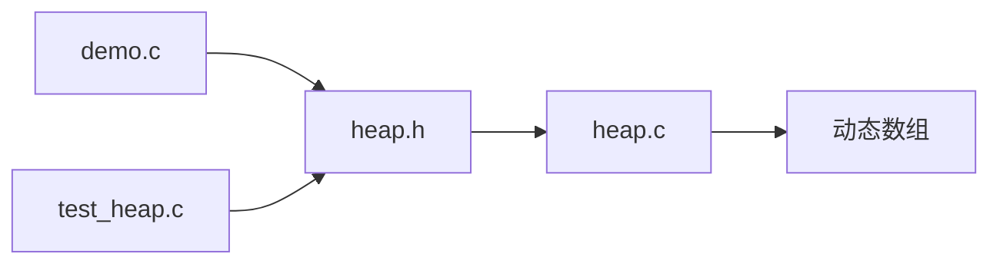
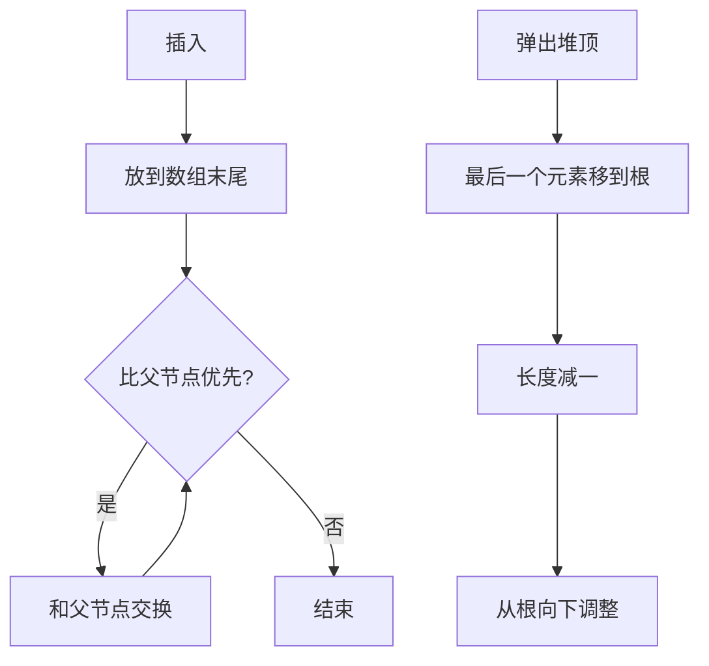

# 堆（C 语言实现）

[](https://en.wikipedia.org/wiki/C99)
[](LICENSE)

[English](README.md) | 中文

## 项目介绍

这是我练习数据结构时写的一个二叉堆。目标不只是在 `main` 里演示几个操作，而是做成一个能直接拿去用的小库：接口放在 `heap.h`，实现放在 `heap.c`，最小堆和最大堆共用一套代码，只改比较方向。

目前支持这些功能：

- 最小堆和最大堆
- 动态扩容，容量按倍数增长，插入摊还 O(1)
- 从数组建堆，Floyd 算法，O(n)
- 原地堆排序，升序降序都行
- 弹出堆顶、查看堆顶、按下标删除
- 层序和树形两种打印方式，调试时方便看结构
- 空堆、`NULL`、越界下标都有保护

调用方只依赖 `heap.h`，文件之间的关系很简单：



插入和弹出是堆的两个核心动作，流程如下：



## 依赖说明

没有第三方依赖，只需要一个支持 C99 的编译器。


开发时用 GCC 15.2 编译，开启 `-std=c99 -Wall -Wextra` 没有警告。代码没有用平台相关接口，Clang 理论上也能直接编，但我没逐项验证过。

## 项目结构

```
.
├── heap.h        公开接口
├── heap.c        实现
├── demo.c        演示程序
├── test_heap.c   测试
├── LICENSE
├── README.md     英文说明
└── README_cn.md  中文说明
```

## 使用说明

直接用 gcc 编译，不需要 Makefile 或 CMake：

```bash
# 演示程序
gcc -std=c99 -O2 -Wall -Wextra -o demo demo.c heap.c
./demo

# 测试
gcc -std=c99 -O2 -Wall -Wextra -o test_heap test_heap.c heap.c
./test_heap
```

Windows 下生成的是 `demo.exe` 和 `test_heap.exe`，在 PowerShell 或 CMD 里直接运行即可。测试一共 7 组，全部通过时进程返回 0。

基本用法：

```c
#include "heap.h"

Heap *h = heap_create(0, MIN_HEAP);  // 容量传 0，表示先不分配，插入时再扩。
heap_push(h, 5);
heap_push(h, 3);
heap_push(h, 8);

int top;
heap_peek(h, &top);  // top = 3

int value;
heap_pop(h, &value); // value = 3

heap_destroy(h);
```

查询接口在 `heap` 为 `NULL` 时返回 0 或 `false`，修改接口直接返回 `false`。`out_value` 可以传 `NULL`，表示只关心操作有没有成功。

| 函数 | 作用 | 时间复杂度 |
| ---------------------------------------- | -------------------- | ---------- |
| `heap_create(capacity, type)` | 创建堆，容量可传 0 | O(1) |
| `heap_destroy(heap)` | 销毁堆 | O(1) |
| `heap_push(heap, value)` | 插入元素 | O(log n) |
| `heap_pop(heap, out_value)` | 弹出堆顶 | O(log n) |
| `heap_peek(heap, out_value)` | 查看堆顶 | O(1) |
| `heap_remove_at(heap, index, out_value)` | 删除指定下标的元素 | O(log n) |
| `heap_size(heap)` | 获取元素个数 | O(1) |
| `heap_capacity(heap)` | 获取当前容量 | O(1) |
| `heap_is_empty(heap)` | 判断是否为空 | O(1) |
| `heap_type(heap)` | 获取堆类型 | O(1) |
| `heap_build(arr, n, type)` | 从数组建堆 | O(n) |
| `heap_print(heap)` | 按层序打印 | O(n) |
| `heap_print_tree(heap)` | 打印树形结构 | O(n) |
| `heap_sort(arr, n, ascending)` | 原地堆排序 | O(n log n) |

## 贡献指南

发现问题可以直接提 issue，附上复现用的数据和编译环境就行。

想改代码的话，先跑一遍 `test_heap`，确认 `-Wall -Wextra` 没有警告。如果动了公开接口，记得同步改头文件注释、测试和两份 README。提交信息写清楚改了什么、为什么改，不需要太正式。

## 联系作者

谙弆悕博士（Ailan Anjuxi）

📫 邮箱：anjuxi.ME@outlook.com

📞 SIP 电话：sip:anjuxi@sip.linphone.org
